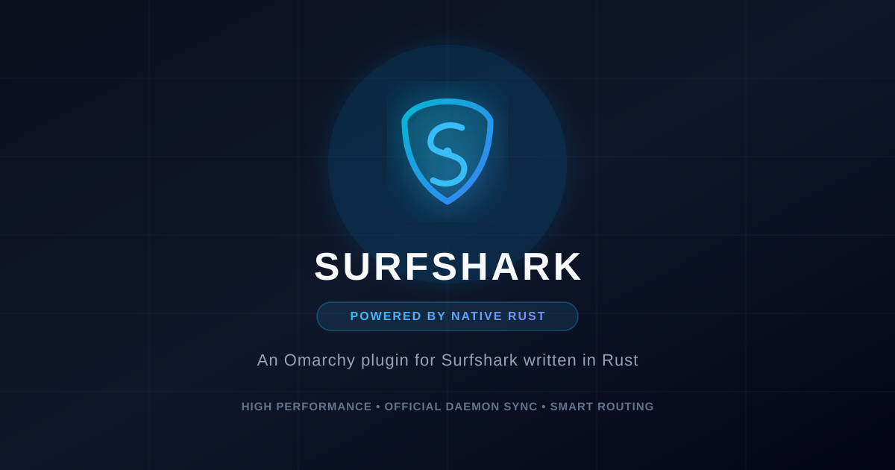

<div align="center">

# Surfshark for Omarchy (Rust Edition)

**An Omarchy plugin for Surfshark written in Rust.**

[](LICENSE)



</div>

> **Unofficial.** This project is not affiliated with, endorsed by, or supported by Surfshark. It communicates with the official Linux client's helper daemon to drive the VPN tunnel natively.

## Requirements

- Omarchy shell (`quickshell`)
- Official Surfshark Linux client installed and logged in (`surfshark-client` on Arch/AUR)
- NetworkManager (used by the client to bring the tunnel up)

## Install

```sh
omarchy plugin add https://github.com/daailouivan/omarchy-surfshark.git --enable
omarchy bar move daailouivan.surfshark --after omarchy.network
omarchy restart shell
```

## Features

- **Blazing Fast**: Native Rust binary (`bin/omarchy-surfshark`) replacing legacy scripts with instant response times.
- **Redesigned UI & Icon**: Custom cyber shield security emblem and modern telemetry tiles.
- **Official Client Harmony**: Communicates directly with `surfsharkd` so state is always in sync with the official app.
- **Smart Routing**: One-click connect to fastest server, nearest abroad, local country, pinned US exit, or random country.
- **Full Search**: Filter through all available global Surfshark clusters.
- **Recents**: Persistent and merged recents with clear/restore capabilities.
- **Hotkeys**: Keyboard navigation inside the panel (`t` to toggle, `f` fastest, `n` nearest, `s` same, `u` US, `x` random, `r` refresh, `/` search).

## Development & Building

To rebuild the native backend from source:

```sh
cargo build --release
cp target/release/omarchy-surfshark bin/omarchy-surfshark
```
